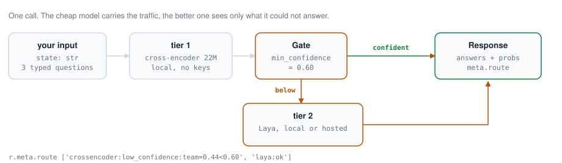

<div align="center">

<h1>pydecide</h1>

<p><b>One Python client for typed decisions, with a confidence gate between the cheap model and the good one.</b></p>

<p>
<a href="https://github.com/gopaljigaur/decide/actions/workflows/ci.yml"></a>
<a href="https://pypi.org/project/pydecide/"></a>
<a href="https://pypi.org/project/pydecide/"></a>
<a href="https://pypi.org/project/pydecide/"></a>
<a href="LICENSE"></a>
</p>

<picture>
  <source media="(prefers-color-scheme: dark)" srcset="docs/chain-dark.svg">
  
</picture>

</div>

Routing, triage and guardrail calls do not need a chat model. A decision model
takes a state and typed questions (pick one of these, score this, yes or no)
and answers with probabilities, in milliseconds. `pydecide` speaks to all of
them through one API: TypeSafe's hosted Jev, OpenRouter, OpenAI's Decisions
endpoint, the open-weight laya family on PyTorch and MLX, any
sentence-transformers CrossEncoder, and a JSON-prompted LLM as a last resort.

The reason to use it over any single backend's SDK is the chain. A `Client`
takes an ordered list of backends and a confidence policy. A backend that
errors, or that answers below its threshold, hands the question to the next
one, so a local model carries the traffic and a hosted model sees only what
the local one could not answer. Every response records the route it took.

|  |  |
|---|---|
| **One API, seven backends** | Local and hosted behind the same `Choice`, `Score` and `Noul` types. |
| **Confidence gate** | Per call, per question, or per question type. Score answers are never gated, and [Gating](docs/gating.md) says why. |
| **Local only on request** | `DECIDE_LOCAL_ONLY=1` refuses every backend that would send the state to a server, whatever keys are set. [Gating](docs/gating.md). |
| **Readable routes** | `r.meta.route` is `['crossencoder:low_confidence:team=0.44<0.60', 'laya:ok']`, not a boolean. |
| **Drop-in for typesafe-sdk** | Swap one import and keep your questions, calls and response objects. [Limits](docs/typesafe-sdk.md). |
| **A server and a CLI** | `decide serve` speaks TypeSafe's wire format; `decide ask` answers from the shell. |
| **20.9 ms** | Median for one Choice question on an M4 with laya-mlx, in process. Measured, method in [Latency](#latency). |

## Install

```bash
uv tool install pydecide   # the decide CLI on your PATH, from any directory
uv add pydecide            # inside a project
```

With pip: `pip install pydecide` / `pipx install pydecide`. Either way, this
includes the CLI, the hosted backends and the server.

Local model backends need an extra:

```bash
uv tool install "pydecide[all]"
```

With pip: `pip install "pydecide[all]"`. Quote the brackets in zsh, since it
otherwise tries to glob them. This pulls in PyTorch and MLX, about 2 GB.

| Extra | Adds |
|---|---|
| `server` | Nothing further; kept as an empty extra so `pip install "pydecide[server]"` still works. FastAPI and uvicorn ship in the base install. |
| `laya` | `laya` backend (PyTorch) |
| `mlx` | `laya_mlx` backend (Apple Silicon; needs Python 3.11+) |
| `st` | `crossencoder` backend (sentence-transformers) |
| `all` | `laya` + `mlx` + `st` |

The `mlx` extra depends on `laya-mlx`, which requires Python 3.11 or newer;
on 3.10 the extra installs nothing and the `laya_mlx` backend is
unavailable.

## Quickstart: zero configuration

Install a local backend and `decide ask` works right away, with no
environment variables at all:

```bash
uv tool install "pydecide[mlx]"    # Apple Silicon
# or
uv tool install "pydecide[laya]"   # any platform (PyTorch)
```

```bash
decide ask "I had a rough day, everything broke" --noul "Is the writer doing well?" --choice good,bad
```

```
NAME    TYPE    ANSWER  PROBABILITIES
choice  choice  bad     good=0.01 bad=0.99
noul    noul    false   0.01
backend=laya_mlx route=laya_mlx:ok latency=56.5ms
```

This is the real output of that command, run with `laya_mlx` installed and
none of `DECIDE_LOCAL_MODEL`, `TYPESAFE_API_KEY`, `OPENROUTER_API_KEY`,
`OPENAI_API_KEY`, `DECIDE_LLM_BASE_URL` or `DECIDE_BACKENDS` set.

The Python client works the same way. `Client.from_env()` builds a backend
chain from whatever is installed and configured in the process environment;
with a local backend installed, it needs no variables either. Pass an
explicit `env=` mapping instead (e.g. in tests) to configure from something
other than `os.environ`:

```python
from decide import Client, Choice, Score, Noul

client = Client.from_env()

r = client.decide(
    state={"ticket": "I was charged twice, please refund."},
    questions={
        "team": Choice(
            "Which team handles this?",
            {
                "billing": "charges, refunds",
                "engineering": "bugs and outages",
                "sales": "pricing and upgrades",
            },
        ),
        "severity": Score("How severe is this?", ["minor", "degraded", "blocked"]),
        "refund": Noul("Does the customer ask for money back?"),
    },
)

r.choices["team"].choice  # "billing"
r.choices["team"].probabilities  # {"billing": 0.9763, "engineering": 0.0107, "sales": 0.013}
r.scores["severity"].score  # 1.6284  (expected level index, 0..len(levels)-1)
r.scores["severity"].probabilities  # [0.0802, 0.2112, 0.7086]
r.nouls["refund"].noul  # 0.8919
r.meta.backend  # "laya_mlx"
r.meta.latency_ms  # 50.0
r.meta.route  # ["laya_mlx:ok"]
```

This was run against the `laya_mlx` backend with no environment variables
set at all, using its own default checkpoint; every value above is the real
output of that run, not illustrative.

`from_env` picks the chain in this order, using whatever is installed and/or
configured: `laya_mlx` or `laya`, whichever is importable, with its own
default model unless `DECIDE_LOCAL_MODEL` overrides it; `typesafe` (if
`TYPESAFE_API_KEY` is set); `openrouter` (if `OPENROUTER_API_KEY` is set);
`openai_decisions` (if `OPENAI_API_KEY` is set and `DECIDE_OPENAI_DECISIONS` is not `0`);
`llm` (if `DECIDE_LLM_BASE_URL` or `OPENAI_API_KEY` is set). A local backend,
when installed, is tried first, with the hosted backends as fallback. Set
`DECIDE_BACKENDS="laya,typesafe"` to override the order explicitly, or
`DECIDE_LOCAL_ONLY=1` to drop every hosted backend whatever keys are in the
environment, which also makes `Client([...])` refuse one. If
nothing is importable or configured, `from_env` raises `ConfigError` telling
you to install a local backend or set a hosted one's API key.

`AsyncClient` has the same surface, `await`ed: `await client.decide(...)`,
`await client.decide_batch(...)`, `AsyncClient.from_env(...)`.

## Documentation

| | |
|---|---|
| [Backends](docs/backends.md) | The seven backends, the environment variables that pick them, and running the typesafe backend against any other `/v1/systemone` server. |
| [Gating and fallback](docs/gating.md) | How the chain escalates, choosing a threshold, and the entropy, margin, conformal and calibrated policies. |
| [Server](docs/server.md) | `decide serve`, which speaks TypeSafe's wire format so a non-Python service can call a local chain. |
| [CLI](docs/cli.md) | `decide ask` and the rest of the command line. |
| [Already using typesafe-sdk?](docs/typesafe-sdk.md) | The compatibility client, and what it does not support. |

## Latency

Measured on an Apple M4 (32 GB) with the `laya_mlx` backend (laya-mlx 0.4.0)
on its default checkpoint, `aac6fef/laya-mlx`, in process, after three warm-up
requests. One `Client.decide` call, timed by `meta.latency_ms`, 20 samples:

| Request | Median | Range |
|---|---|---|
| One Choice question | 20.9 ms | 19.4 to 24.0 ms |
| Choice, Noul and Score in one call | 38.1 ms | 37.3 to 41.0 ms |

Loading the model and answering the first request took 1,304 ms, once. A
`decide` CLI invocation on the same machine takes 0.7 to 1.3 s of wall clock,
most of it interpreter startup and loading the model again, while the decision
inside it measures 56 to 144 ms. Measure in process if you are comparing
against a hosted API.

Your numbers will differ with the machine, the checkpoint and the length of
the state, so measure before you rely on any of this. `--verbose` prints the
backend, the route and the latency of the call:

```bash
decide ask "I was charged twice" --choice billing,engineering --verbose
```

```
NAME    TYPE    ANSWER   PROBABILITIES
choice  choice  billing  billing=0.99 engineering=0.01
backend=laya_mlx route=laya_mlx:ok latency=45.4ms
```

That one is a cold call with no warm-up, which is why it is slower than the
table above.

## What the probabilities mean

Every probability in a `ChoiceAnswer`, `ScoreAnswer` or `NoulAnswer` is
whatever the backend reported; `decide` does not calibrate, smooth or
verify it. What that means differs by backend: `typesafe`, `openrouter`, `openai_decisions` and
`laya`/`laya_mlx` are purpose-built decision models, but their outputs are
still self-reported by the model and not audited by this library. The
`crossencoder` backend turns a relevance reranker's raw logits into a
softmax or sigmoid, so the result is a *normalized score* forced to distribute
mass over the supplied candidates, not a calibrated probability; a `Choice`
will still pick a winner even when every candidate is a bad fit, and a
`Noul` of 0.9 does not mean the condition holds 90% of the time. The `llm`
backend is the least trustworthy of all: it prompts a general chat model to
estimate its own confidence in JSON, with no guarantee the model attends to
every candidate or keeps its numbers well calibrated. Treat all of this
accordingly, as a signal to gate and fall back on, not as ground truth.

## Status

The public API may still change before a 1.0 release. The current version is
the one in the PyPI badge above, and the [changelog](CHANGELOG.md) says what
changed.

## License

MIT, see [LICENSE](LICENSE).
